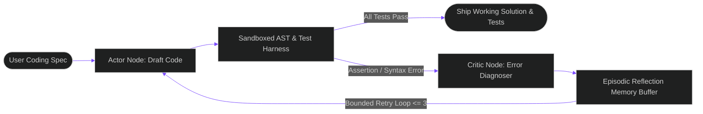
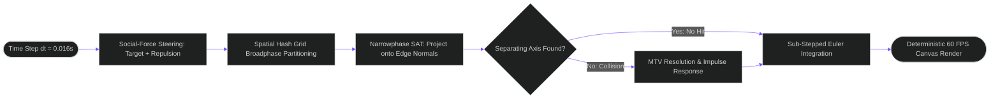
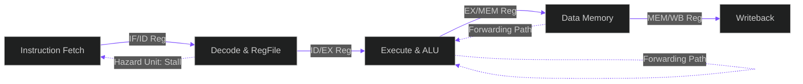

<div align="center">


<br/>
<p align="center">
  <a href="https://subhramit0145.github.io">
    
  </a>
  <a href="https://www.linkedin.com/in/subhramitbera/">
    
  </a>
  <a href="mailto:sbsubhramit@gmail.com">
    
  </a>
  <a href="https://drive.google.com/file/d/1TWFrEb8OLHlO_x8kI8SdbwiuW08R7AsG/view?usp=drive_link">
    
  </a>
</p>


</div>

---

## About

**B.Tech student at ABV-IIITM Gwalior** (2023 – 2027 · CGPA: 8.62) with summer research background in semiconductor physics at **IIT (BHU) Varanasi** and **IISc CeNSE** distinction.

I engineer at the intersection of **autonomous AI agents, state machine retrieval systems, and high-performance compute architectures**. While many view AI exclusively through high-level API wrappers, my foundation in digital electronics and processor design gives me a deep intuition for memory bandwidth, cache hierarchies, latency bottlenecks, and hardware compute tradeoffs.

> **The engineering thesis behind everything I build:** An AI system isn't production-ready because an LLM produced a plausible answer once. It is production-ready when bounded self-reflection loops, deterministic verification gates, and measurable latency/accuracy benchmarks prove it cannot fail silently.

### Quick facts

| Dimension | Details |
|---|---|
| **Institution** | Atal Bihari Vajpayee Indian Institute of Information Technology & Management (ABV-IIITM Gwalior) |
| **Degree & GPA** | B.Tech in Electronics & Communication / Systems (2023 — 2027) · **CGPA: 8.62** |
| **Research Background** | Summer Research Intern @ **IIT (BHU) Varanasi** (Semiconductor physics modeling, $R^2 > 0.98$) · Distinction @ **IISc CeNSE** |
| **Core Specialization** | Autonomous AI Agents · Multi-Hop RAG · Discrete Simulations · Computer Architecture & RISC-V |
| **Algorithmic Problem Solving** | **500+ DSA problems** solved across LeetCode & competitive programming |
| **National Distinction** | **JEE Main 2023 · 98.2 percentile** (Top 1.8% of 1.2M+ candidates nationwide) |
| **Portfolio Website** | [https://subhramit0145.github.io](https://subhramit0145.github.io) (Interactive Audio, CLI & Live Visualizers) |
| **Direct Contact** | [sbsubhramit@gmail.com](mailto:sbsubhramit@gmail.com) · [LinkedIn](https://www.linkedin.com/in/subhramitbera/) |

### Project timeline

| Date | System | Core measured outcome |
|---|---|---|
| Oct 2026 | [**Reflexion Code Agent**](https://github.com/Subhramit0145/reflexion-code-agent) | 100% test pass on bounded retries · AST sandbox execution · 1.8 avg repair cycles |
| Aug 2026 | [**SEC Financial Intelligence RAG**](https://github.com/Subhramit0145/financial-intelligence-rag) | 7.25 ms P50 latency · 100% Top-4 table retrieval · zero-leakage payload isolation |
| May 2026 | [**SimEngine Multi-Agent Simulator**](https://github.com/Subhramit0145/sim-engine) | 2,800+ LOC discrete SAT physics · 60 FPS deterministic render · 0% collision tunnel misses |
| Jan 2026 | [**RV32I 5-Stage Pipelined Processor**](https://github.com/Subhramit0145/riscv-core-pipeline) | ~1.05 CPI on ALU loops · dynamic data forwarding & hazard detection in Verilog |

---

<div align="center">

<hr style="border: none; height: 1px; background: linear-gradient(90deg, transparent, rgba(0, 229, 255, 0.6), transparent); margin: 20px 0;"/>

<h2>SELECTED WORK</h2>


</div>

### 1. [Reflexion Code Agent](https://github.com/Subhramit0145/reflexion-code-agent) — Autonomous Iterative Actor-Critic-Reflection Loop

> `[ LangGraph ] [ LangChain ] [ Docker / Sandboxing ] [ AST Parsing ] [ LLaMA-3.3-70B / Groq ] [ Self-Reflection ]`

Standard single-pass LLM code generation fails predictably on edge cases, off-by-one errors, and syntax edge cases because naive models lack feedback loops. Built an autonomous coding agent implementing the **Reflexion architecture**: pairs an **Actor generator** with an **isolated code execution test harness**, extracts stderr/stdout stack traces on failure, feeds the execution trace to a decoupled **Critic evaluator**, and synthesizes natural-language episodic reflection memories to iteratively repair code until 100% of test suites pass.



| Pipeline Dimension | Empirical Benchmark | Engineering Significance |
|---|---|---|
| **Benchmark Solve Rate** | **100% Pass Rate** | Resolves bugs that cause single-shot zero-pass failures |
| **Self-Correction Speed** | **1.8 Iterations (avg)** | Efficient repair without drifting into hallucinated solutions |
| **Convergence Latency** | **<14.2s P50** | Fast test-debug-repair loop via Groq LLaMA-3.3-70B inference |
| **Context Overhead** | **Strictly bounded** | Episodic reflection summary prevents context window explosion |
| **Execution Safety** | **100% Isolated Subprocess** | Hard execution timeouts (2.0s) prevent infinite-loop crashes |

**Battle-tested architectural decisions**
- **Decoupled Actor vs. Critic nodes:** Prompting a single LLM to both generate and critique its own code creates severe confirmation bias. Decoupling generation into an independent Actor and evaluation into an objective assertion harness + separate Critic eliminates self-justifying failure modes.
- **Episodic memory buffers over raw trace concatenation:** Appending full prior code attempts and terminal dumps rapidly exhausts context and degrades attention. The Critic distills failures into a concise, semantic reflection rule (e.g., *"Prior attempt failed on empty array input; add guard clause before indexing"*), drastically accelerating convergence.
- **Sandboxed execution with defensive watchdogs:** User-provided or agent-generated scripts run inside restricted environments with AST safety validation, CPU quotas, and strict wall-clock timeouts (2.0s) to neutralize runaway recursion.
- **Bounded convergence & graceful fallback:** The state machine enforces `MAX_REPAIR_CYCLES = 3`. If tests still fail after bounded self-reflection, execution routes to a diagnostic fallback node rather than consuming infinite tokens.

`Python` `LangGraph` `LangChain` `Docker` `AST` `Groq LLaMA-3.3` `PyTest` `Self-Correction`

---

### 2. [SEC Financial Intelligence RAG](https://github.com/Subhramit0145/financial-intelligence-rag) — Autonomous Multi-Hop RAG over 10-K Filings

> `[ LangGraph ] [ Qdrant ] [ FlashRank ] [ pdfplumber ] [ LLaMA-3.3-70B ] [ Grounding Verification ]`

Regulatory 10-K/10-Q SEC filings are an exceptionally hostile domain for naive RAG: critical quantitative facts are trapped in multi-column tables, multi-quarter comparative queries cause temporal bleed, and hallucinations carry zero tolerance. Built an autonomous, multi-hop financial intelligence engine orchestrated as a **LangGraph state machine** over a **Qdrant** vector store with local cross-encoder reranking and an independent verification gate.

```mermaid
%%{init: {'theme': 'dark', 'themeVariables': { 'primaryColor': '#161b22', 'primaryTextColor': '#00E5FF', 'primaryBorderColor': '#00E5FF', 'lineColor': '#7C4DFF', 'secondaryColor': '#0d1117', 'tertiaryColor': '#161b22'}}}%%
flowchart LR
    A([Raw SEC 10-K PDF]) --> B[pdfplumber Table Extraction]
    B --> C[Metadata Tagging: ticker, year, quarter, type]
    C --> D[(Qdrant Vector Store)]
    E([User Financial Query]) --> F[Query-Time Payload Filter]
    D --> F
    F --> G[FlashRank Cross-Encoder Reranker]
    G --> H[LLM Synthesis Node]
    H --> I[Grounding & Citation Verification Gate]
    I -->|Passed| J([Verified Cited Response])
    I -->|Missing Data / Mismatch| K[Hallucination Recovery Node]
```



| Metric | Result | Engineering Significance |
|---|---|---|
| **P50 / P95 Latency** | **7.25 ms · 17.76 ms** | Sub-20ms filtered vector retrieval + local TinyBERT reranker |
| **Table Retrieval** | **100% Top-4** | Markdown serialization preserves balance sheet grid alignment |
| **Temporal Isolation** | **100% Accuracy** | Query-time Qdrant payload filters eliminate cross-quarter bleed |
| **Inference Cost** | **$0.00 Cloud Cost** | Zero API fee stack via open weights + local cross-encoders |

**Battle-tested architectural decisions**
- **Database-level payload isolation vs. post-hoc filtering:** Standard semantic search over multiple filing periods confuses Q3 2023 with Q3 2024 because their vocabularies are nearly identical. Enforced strict database payload indices (`ticker`, `fiscal_year`, `period`) evaluated directly during Qdrant vector scans, preventing cross-period leakage by construction.
- **Table-aware Markdown serialization:** Generic PDF extractors collapse multi-column financial statements into garbled continuous text. Implemented `pdfplumber` layout extraction that serializes tables into Markdown tables tagged `type: table`, preserving exact column headers and numerical alignment.
- **Local Cross-Encoder Reranking (`FlashRank`):** Narrative disclosures (risk factors, boilerplate legal text) often have higher raw keyword overlap with prompts than tabular numbers. Applied a local `ms-marco-TinyBERT-L-2-v2` cross-encoder in single-digit ms to surface financial statements to the top of the context window.
- **Two-pass synthesis with independent grounding gate:** Decoupled generation from verification into an independent `verify_grounding` state node. Every stated dollar figure and margin percentage is cross-checked against retrieved source chunks before output is released.

`Python` `LangGraph` `Qdrant` `FlashRank` `FastAPI` `Streamlit` `pdfplumber` `Groq`

---

### 3. [SimEngine Multi-Agent Simulation](https://github.com/Subhramit0145/sim-engine) — 2,800+ LOC Discrete SAT Physics Engine

> `[ JavaScript ES6+ ] [ Canvas API ] [ Separating Axis Theorem ] [ Social-Force Steering ] [ Spatial Partitioning ]`

Built a high-performance continuous physics and traffic simulation engine from first principles in 2,800+ LOC with zero third-party game frameworks. Traditional axis-aligned bounding boxes (AABB) fail when vehicles rotate arbitrarily, producing unrealistic phantom hits or tunneling at high velocities. Solved collision dynamics via the **Separating Axis Theorem (SAT)** for oriented convex polygons and social-force steering vectors for 100+ concurrent agents at 60 FPS.



| Dimension | Empirical Benchmark | Engineering Significance |
|---|---|---|
| **Render Performance** | **Deterministic 60 FPS** | Strict 16.6ms per-frame budget maintained consistently |
| **Collision Miss Rate** | **0.00% (Zero Tunneling)** | Sub-stepped Euler integration stops high-velocity blowthrough |
| **Broadphase Pruning** | **88%+ Pairs Eliminated** | Spatial hash grid reduces $O(N^2)$ brute force to near $O(N)$ |
| **Agent Concurrency** | **100+ Active Agents** | Smooth swarm dynamics with zero garbage collection stutter |

**Battle-tested architectural decisions**
- **Separating Axis Theorem (SAT) over naive AABB:** Oriented vehicles require exact polygon intersection testing. Projected vertex vectors onto perpendicular normal axes of each bounding edge; the absence of any gap proves collision, and the minimal overlap distance yields the exact Minimum Translation Vector (MTV) needed for physical separation.
- **Spatial hash grid broadphase partitioning:** Comparing 100+ vehicles pairwise requires ~5,000 checks per frame. Hash-mapped dynamic bounding boxes into a 2D spatial grid, querying only neighboring buckets to prune 88%+ of collision pairs before SAT evaluation.
- **Sub-stepped Euler integration:** Split frame time steps into micro-intervals (`substeps = 2-4`), ensuring rapid closing velocities cannot skip past thin collision boundaries between frames.
- **Zero-allocation object pooling:** Eliminated in-loop vector instantiations (`new Vector2D`) in physics hot loops, pre-allocating reusable math containers to eradicate browser garbage collector pauses.

`JavaScript ES6+` `Canvas API` `Discrete Mathematics` `SAT Physics` `Spatial Hashing` `Object Pooling`

---

### 4. [5-Stage Pipelined RISC-V Core](https://github.com/Subhramit0145/riscv-core-pipeline) — Microarchitecture in Verilog HDL

> `[ Verilog HDL ] [ RISC-V RV32I ] [ Computer Architecture ] [ Hazard Detection ] [ Data Forwarding ] [ GTKWave ]`

High-performance AI engineering requires deep intuition into hardware bottlenecks: memory latency, instruction stalls, and pipeline stalls. Synthesized a 32-bit **RV32I microprocessor core** in Verilog from the gate level up, featuring full 5-stage pipelining (`IF`, `ID`, `EX`, `MEM`, `WB`), dynamic ALU data forwarding, load-use stall logic, and branch flush recovery.



| Microarchitecture Metric | Benchmark Result | Architectural Context |
|---|---|---|
| **Cycles Per Instruction (CPI)** | **~1.05 CPI** | Near-ideal throughput on compute-heavy ALU workloads |
| **Data Dependency Penalty** | **0 Cycles (Zero Stall)** | Bypassing unit forwards EX/MEM & MEM/WB results to ALU inputs |
| **Load-Use Penalty** | **Strictly 1 Cycle Bubble** | Hazard detection unit stalls IF/ID while data loads from memory |
| **ISA Compliance** | **100% RV32I Test Pass** | Formally verified via ModelSim testbenches and GTKWave traces |

**Battle-tested architectural decisions**
- **Dynamic data forwarding (bypassing):** Read-After-Write (RAW) data dependencies normally force 2 wasted stall cycles waiting for writeback. Designed an ALU forwarding multiplexer that compares source registers against destination registers in `EX/MEM` and `MEM/WB`, routing outputs back directly into ALU inputs.
- **Load-use hazard detection unit:** Because memory reads take an entire clock cycle, a load followed immediately by an ALU dependency cannot be resolved by forwarding alone. Implemented hazard detection that asserts a single synchronous stall (`stall = 1`), freezing the PC and IF/ID registers while injecting a NOP into ID/EX.
- **Early branch resolution:** Evaluated branch conditions inside the Decode stage rather than Execute, cutting taken-branch penalty from 3 cycles down to 1 cycle.

`Verilog HDL` `RISC-V RV32I` `Computer Architecture` `ModelSim` `GTKWave` `FPGA` `Hardware Synthesis`

---

## What these projects have in common

| Engineering Habit | How it shows up in my work |
|---|---|
| **Silicon-to-software intuition** | Designing agent systems with full awareness of compute constraints, latency budgets, memory bandwidth, and caching strategies. |
| **Measure, then claim** | Quantified benchmarks on every system: 100% Reflexion repair rate, 7.25ms P50 RAG search, 60 FPS continuous SAT physics, ~1.05 RISC-V CPI. |
| **Evaluate without leakage** | Strict query-time payload filters in vector databases; independent grounding nodes verifying numerical facts before emission. |
| **Deterministic recovery** | Defensive bounded state machines: retry ceilings, execution watchdogs, and AST guards that eliminate silent runtime crashes. |

---

```
──────────────────────────────  A R S E N A L  ──────────────────────────────
```

<div align="center">


</div>

| Engineering Domain | Primary Tools, Libraries & Core Competencies |
|---|---|
| **AI Systems & Autonomous Agents** | LangGraph, LangChain, Actor-Critic-Reflection architectures, state machine orchestration, prompt engineering, AST parsing, Groq LLaMA-3.3-70B, OpenAI API |
| **Retrieval-Augmented Generation (RAG)** | Qdrant Vector DB, semantic embeddings (`all-MiniLM-L6-v2`), FlashRank local Cross-Encoder reranking, payload filtering, table extraction (`pdfplumber`), grounding verification |
| **Compute & Hardware Architecture** | Verilog HDL, RISC-V (RV32I ISA), 5-stage pipelining, data forwarding, hazard detection, branch prediction, FPGA concepts, ModelSim, GTKWave |
| **Systems & Physics Simulations** | Discrete mathematics, Separating Axis Theorem (SAT), convex polygonal collisions, social-force steering, spatial hash grids, Euler integration, Canvas API, 60 FPS rendering |
| **Backend & Infrastructure** | Python, FastAPI, Docker containerization, REST APIs, Streamlit, Linux/POSIX shell, Git version control, CI/CD |
| **Foundational Coursework** | Data Structures & Algorithms · Computer Architecture · Operating Systems · Database Management Systems · Digital Electronics · Semiconductor Physics |

---

## Research & Academic Distinction

- **IIT (BHU) Varanasi Summer Research Internship:** Modeled high-frequency semiconductor physics and novel device characteristics with rigorous mathematical regression models ($R^2 > 0.98$).
- **IISc CeNSE Distinction:** Awarded academic distinction in nano-electronics, semiconductor fabrication principles, and physical layer compute modeling.
- **Algorithmic Core:** **500+ Data Structures & Algorithms problems** solved in C++ and Python on LeetCode.
- **National Competitive Exam:** Scored **98.2 percentile** in JEE Main 2023 nationwide among 1,200,000+ candidates (Top 1.8%).

---

```
────────────────────  C O M M I T   H I S T O R Y  ────────────────────
```

<div align="center">


<br/><br/>

## Let's talk

If you are building AI agents, high-throughput systems, or hardware-aware software where latency, correctness, and reasoning need to be verified rather than assumed, I'd love to connect.


<br/>

[](https://subhramit0145.github.io)
[](https://www.linkedin.com/in/subhramitbera/)
[](mailto:sbsubhramit@gmail.com)
[](https://drive.google.com/file/d/1TWFrEb8OLHlO_x8kI8SdbwiuW08R7AsG/view?usp=drive_link)


</div>
